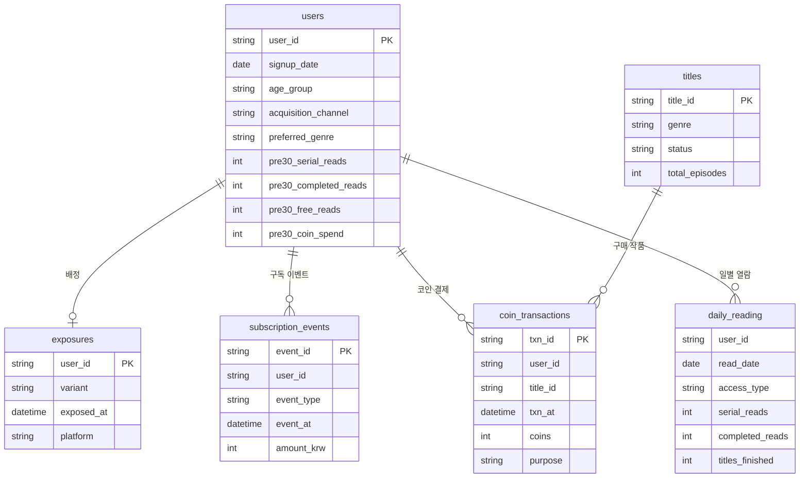

# 데이터 구조 설계

## 1. 요약

- 6개 테이블 구성 (유저, 실험 배정, 구독 이벤트, 코인 결제, 일별 열람, 작품)
- 테이블별 로그 분리 저장, 분석 시 `user_id` 기준 결합

## 2. 테이블 정의

### 2.1 users (유저 정보)

- 실험 대상 유저 1명당 1행
- 읽기 패턴은 컬럼 미제공, 실험 전 30일 열람 기록(`pre30_*`)으로 분석 시 직접 분류

| 컬럼 | 타입 | 설명 |
| --- | --- | --- |
| user_id | string | 유저 ID (PK) |
| signup_date | date | 가입일 |
| age_group | string | 10대 / 20대 / 30대 / 40대 이상 |
| acquisition_channel | string | organic / paid_ad / sns |
| preferred_genre | string | 실험 전 30일 최다 열람 장르 |
| pre30_serial_reads | int | 실험 전 30일 연재작 열람 회차 수 |
| pre30_completed_reads | int | 실험 전 30일 완결작 열람 회차 수 |
| pre30_free_reads | int | 실험 전 30일 무료 회차(첫 3화) 열람 수 |
| pre30_coin_spend | int | 실험 전 30일 코인 결제액(원) |

### 2.2 exposures (실험 배정)

- 패스 소개 화면 첫 노출 유저 1명당 1행
- SRM 체크 및 체험 시작률 계산 기준

| 컬럼 | 타입 | 설명 |
| --- | --- | --- |
| user_id | string | 유저 ID (PK) |
| variant | string | A(7일) / B(14일) |
| exposed_at | datetime | 소개 화면 첫 노출 시각 |
| platform | string | app / web |

### 2.3 subscription_events (구독 이벤트 로그)

- 구독 상태 변경 시마다 1행
- 전환율, 해지율, 패스 매출 산출 기준

| 컬럼 | 타입 | 설명 |
| --- | --- | --- |
| event_id | string | 이벤트 ID (PK) |
| user_id | string | 유저 ID |
| event_type | string | trial_start / trial_cancel / payment / cancel |
| event_at | datetime | 이벤트 발생 시각 |
| amount_krw | int | payment 시 9,900, 그 외 0 |

- trial_cancel: 체험 중 해지, 결제 없이 종료
- payment: 체험 종료 후 첫 결제 및 이후 월 자동 결제
- cancel: 유료 전환 후 해지 (다음 결제일 전까지 이용 가능)

### 2.4 coin_transactions (코인 결제 로그)

- 체험 시작자의 60일간 코인 사용 1건당 1행
- 잠식효과(패스로 인한 코인 매출 감소) 확인 용도

| 컬럼 | 타입 | 설명 |
| --- | --- | --- |
| txn_id | string | 거래 ID (PK) |
| user_id | string | 유저 ID |
| title_id | string | 작품 ID |
| txn_at | datetime | 결제 시각 |
| coins | int | 사용 코인 수 (1코인 = 100원) |
| purpose | string | latest_episode(연재 최신화) / skip_wait(대기 건너뛰기) / completed_episode(완결작 회차) |

### 2.5 daily_reading (일별 열람 요약)

- 체험 시작자의 60일간 열람을 유저 × 날짜 × 이용 방식 단위로 집계
- 회차 단위 원본 로그는 수백만 행 규모로 GitHub 업로드 부적합 → 일 단위 집계
- PK: (user_id, read_date, access_type)

| 컬럼 | 타입 | 설명 |
| --- | --- | --- |
| user_id | string | 유저 ID |
| read_date | date | 열람일 |
| access_type | string | free / wait_free / coin / pass |
| serial_reads | int | 연재작 열람 회차 수 |
| completed_reads | int | 완결작 열람 회차 수 |
| titles_finished | int | 당일 마지막 회차까지 열람한 완결작 수 |

### 2.6 titles (작품 정보)

| 컬럼 | 타입 | 설명 |
| --- | --- | --- |
| title_id | string | 작품 ID (PK) |
| genre | string | 로맨스판타지 / 현대판타지 / 무협 / 로맨스 / 기타 |
| status | string | completed / serial |
| total_episodes | int | 현재까지 공개 회차 수 |

## 3. 데이터 규모 (생성 결과)

| 테이블 | 원본 행 수 | 정제 후 행 수 | 원본 파일 | 용량 |
| --- | --- | --- | --- | --- |
| users | 315,200 | 314,922 | users.csv.gz | 4.0MB |
| exposures | 315,122 | 314,922 | exposures.csv.gz | 2.3MB |
| subscription_events | 61,011 | 60,367 | subscription_events.csv | 3.0MB |
| coin_transactions | 825,552 | 823,238 | coin_transactions.csv.gz | 10.2MB |
| daily_reading | 1,865,128 | 1,859,866 | daily_reading.csv.gz | 6.0MB |
| titles | 6,300 | 6,300 | titles.csv | 0.2MB |

- 원본 행 수는 품질 이슈(테스트 계정, 중복, 유실) 포함 기준
- 정제 후 데이터는 `data/clean/`에 테이블별 `.csv.gz`로 저장 (분석 노트북 입력)
- 설계 단계 예상치 대비 daily_reading(120만 → 187만), coin_transactions(30만 → 83만) 증가
  - 같은 유저·날짜라도 이용 방식(free·wait_free·coin·pass)별로 행 분리
  - 코인 결제를 유저·날짜·구매 목적 단위로 기록
- 대용량 테이블은 `.csv.gz` 압축 저장 (GitHub 파일당 100MB 제한 대응, pandas 직접 로드 가능)
- 코인 결제·열람 기록은 체험 시작자만 생성, 미체험 노출자는 전환율 분모로만 사용

## 4. 데이터 정제용 품질 이슈

- 실제 로그 환경 재현 목적으로 의도적 삽입, 분석 첫 단계에서 탐지 및 정제
- 삽입 규모: [04_generation_rules.md](04_generation_rules.md) 6장

| 이슈 | 위치 | 비중 |
| --- | --- | --- |
| 중복 결제 이벤트 (동일 event_at 2회 기록) | subscription_events | payment의 약 0.5% |
| 내부 테스트 계정 (`test_` 접두 user_id) | 전 테이블 | 약 200명 |
| 노출 기록 없이 체험 시작된 유저 | subscription_events | 약 0.3% |
| 유입 경로 결측 | users | 약 2% |

- 정제 결과: `data/clean/` 저장, 이슈별 탐지·처리 내역은 [02_sanity_check.ipynb](../notebooks/02_sanity_check.ipynb) 참고
